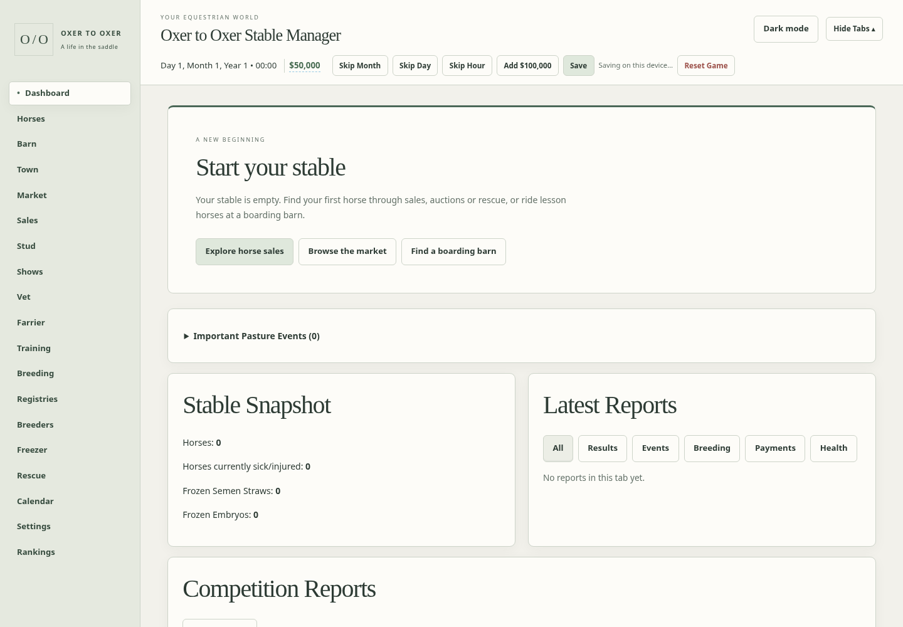
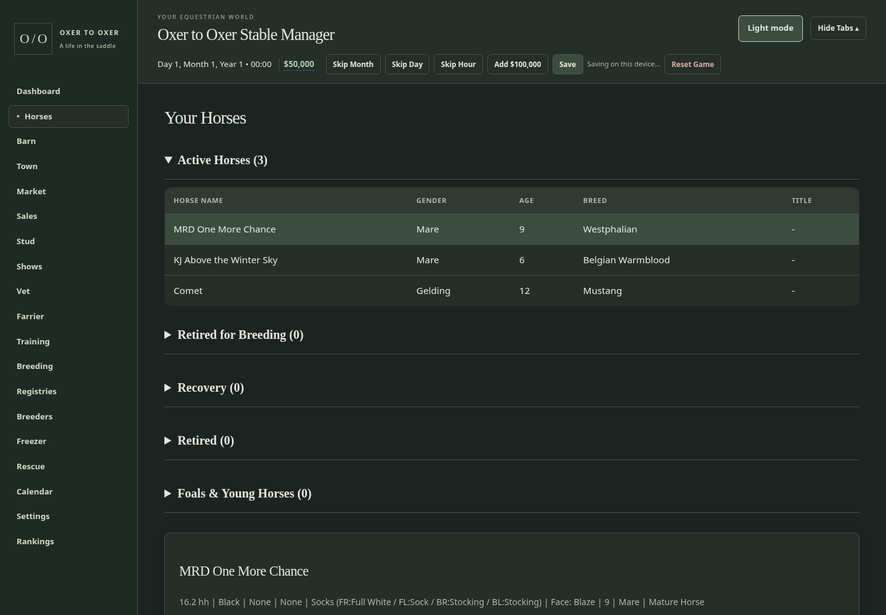
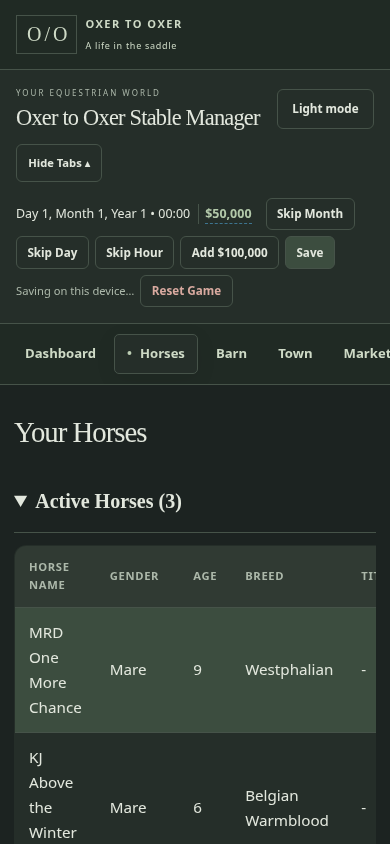

# Oxer to Oxer — quiet stable redesign

Reference: [ERRORSeS/racing-V2](https://github.com/ERRORSeS/racing-V2). The fixed navigation rail, editorial headings, restrained palette and clear management tables inform this design; the Horse-game screens and controls retain their own structure.

Warm ivory, sage and soft stone in light mode; charcoal and muted sage in dark mode. The header switch remembers the device preference independently of career saves. On first use it follows the system theme, including subsequent system changes until a mode is explicitly chosen. No remote fonts, images, polling, render observers or career writes are needed for theme changes.

The redesign covers navigation, dashboard, horse profiles, marketplaces and auctions, sales conversations, care and veterinary panels, calendar, competitions, national teams, rankings, forms and settings. Mobile uses a horizontal scrolling navigation bar; desktop has a scrollable rail. Keyboard focus, reduced motion, disabled controls, recovery controls and navigation disclosure remain available.

## New careers

New careers and resets start with **zero owned horses**, retaining the $50,000 starting balance and the existing sales, auction, rescue and lease systems. The empty dashboard links to horse sales, auctions and boarding barns. Saved horses are never removed during loading or migration. Competition/coat test fixtures now create their own horses explicitly.

## Validation

- `npm run test:appearance-browser`: all 19 tabs in light and dark mode; 390/700/1024px layouts; no page overflow; theme persistence and system preference; menu disclosure; career identity and horse reload; empty new career and all empty-state tabs; first horse sale through the actual contract/payment/transfer controls.
- Native browser regression checks: save recovery and deletion, dressage/eventing and calendar ranking results, coat editing/reload, national team results and main-squad calendar registration.
- Node checks: dressage/eventing formulae, national-team selection/standings, protected face/leg marking source regions.

The full historical `npm test` suite was not run. Some older standalone tests still assume three automatically provided horses and require explicit horse fixtures when run against the new empty-career behavior.

## Previews

