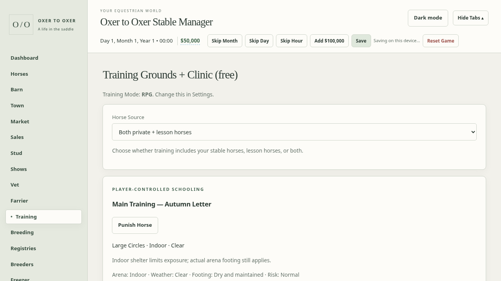
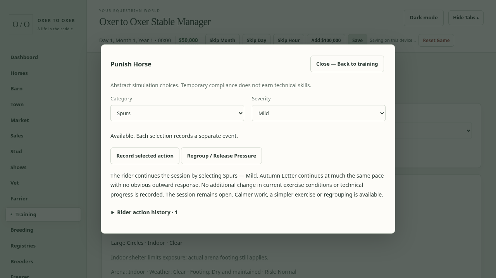

# Rider actions and horse reactions 9.0

Implements the full revised request in [docs/rider-actions105-revised-request.md](docs/rider-actions105-revised-request.md), retaining the equipment/health integration from [the original request](docs/rider-actions105-original-request.md).

## Controls and integration

`training-actions105.js` adds one button to the existing interactive training screen. It does not replace or restyle the screen, its existing controls or its existing history. **Punish Horse** opens a separate native dialog; **Close — Back to training** or Escape closes it and returns to the unchanged training controls. **Record selected action** records one selection. Spurs, Crop and Mouth support Mild, Forceful and Excessive abstract classifications. The panel does not depend on a refusal/concern event or on the Rider Realism story toggle. The older concern buttons route through the same resolver while retaining their existing setting/concern gates. A rejected selection is recorded with its reason, rather than silently doing nothing.

There is no click-count or daily action limit. Routine reactions do not finish the session. Existing serious distress, interrupted work, pending assessments, medical advice and remount restrictions prevent further ridden actions; attempted selections remain recorded. Regrouping, ordinary training controls and voluntary session finishing remain accessible.

## Equipment

Owned equipment uses actual assigned, usable inventory. Free-equipment mode uses the actual equipped catalogue item. Spurs and Crop require their corresponding slots; Mouth requires bitted contact and does not invent bit effects for a hackamore, neck rope or missing bit. No tack items are added.

## Reaction and learning model

Twenty shared reaction outcomes, with multiple phrasings, are available to all three categories. Canter and collected-work outcomes require matching work. Natural intensity/spookiness, existing sensitivity, responsiveness, patience, focus, willingness, trust, relevant confidence, learned sensitivity/anticipation, mood, age/experience, fatigue, difficulty, recent actions and tension shift the probability distribution. Personality never restricts a horse to a small private reaction list. Severity shifts odds without guaranteeing a particular reaction.

Narratives describe the selected category/severity, named horse's resolved visible reaction, actual training-condition consequences and available follow-up. They distinguish first/repeated actions and reference earlier resolved responses. No later exercise result is invented. Brief quickening is an observation, not a technical skill or responsiveness bonus.

Actual effects use `session.temporary` Focus/Balance/Responsiveness and tension, plus the existing `riderBehavior.learned` fields through `tbEvent`, `tbApply` and `tbCommit`. Relevant trust/confidence/avoidance changes persist normally and feed existing training/competition calculations. Existing same-attempt clean-jump/reward learning is revoked once when applicable. No duplicate temperament, trust or injury statistics are created. Technical skills, potential, genetics and markings are not edited by these actions.

## Incidents and welfare

Bucks/rears call the existing `t2xIncident` resolver once, with a unique event ID. Existing rider balance, fall, assessment and recovery decisions remain authoritative; the new action does not add a second rider-fall roll. Narration only mentions an actual resolved incident or fall.

Rare resolved equipment-related clinical events can use existing `oral`/`rub` conditions and unconfirmed observations. No diagnosis or mark is automatically invented after each click. Veterinary assessment, ongoing medical restrictions and treatment remain in the existing health system. Regrouping reduces current tension and partially restores temporary conditions; it does not heal a condition or refund learned trust/confidence.

## Reports, persistence and performance

Each selection retains sequence, category, severity, horse/rider/session identity, in-game time, prior related actions, actual response, condition effects, genuine learned deltas and welfare follow-up. Regrouping and unavailable selections also remain in chronological order. The latest response appears inside the separate action dialog. Action records use the existing plain training-log paragraph formatting; their full history is collapsible and paginated in groups of ten. Completed training reports retain the full action history and factual session summary. Existing reports without this field render normally. No previous saved results are recalculated.

All data lives in the existing session/report/horse save graph; no save migration or separate storage is needed. There is no polling, monthly action simulation or background narrative generation. A matched native-browser fresh-game check measured baseline month skips at 567/459 ms and updated skips at 569/487 ms. These are default fresh-game measurements, not large active-career guarantees; see [validation105/performance.json](validation105/performance.json).

## Validation

A matched native-browser comparison verified the normal training action buttons, labels, original training containers and original observation-history markup against the unchanged baseline. The only excluded new element was the added button and its dialog.

`npm run test:rider-actions-browser` passed native button selection across all categories/severities, twelve repeated uses, no concern/story-toggle dependency for the standalone panel, negative learned changes, protected skills/genetics, report pagination and save/reload. It also checks 120 separately recorded inputs, equipment/free-tack/bitless rules, serious restrictions without an arbitrary session ending, one real buck/rear incident resolution, no invented fall, an unconfirmed existing medical condition, no healing from regroup, no compliance XP, and broad response variation for four personalities.

The earlier repeated-aid browser test also passes, including a seventh use after reload and retained legacy gates. Existing appearance/navigation/theme/purchase, dressage/eventing/calendar, save-recovery browser tests and the 23 dressage/eventing Node scenarios passed. Protected marking-source checks passed. Actual interactive and quick training both completed successfully. The full historical test suite was not run; older standalone tests that assume free starter horses still need explicit fixtures.

